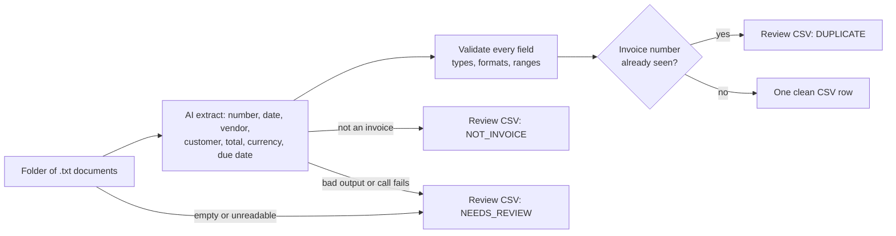

# AI Data Extraction — messy documents → clean CSV

**What this is:** a single-file Python tool that turns a folder of messy invoice documents into one clean CSV.
**What it does:** for each `.txt` document, an AI model (Gemini) extracts the invoice number, date, vendor, customer, total, currency, and due date; the script validates every field, dedupes, and writes clean rows to a CSV — and files everything that did not become a clean row into a review CSV with a reason.
**Who it is for:** anyone who receives bills and invoices in mixed formats and loses time typing them into a sheet by hand — freelancers, agencies, clinics, shops, small finance teams.


Built by [Forethinq Labs](https://github.com/ForeThinq) as a working demo of the data-extraction and cleanup work we do for clients.

**Tested on:** 9 Nov 2026. The full test suite (`python test_extract.py`, 10 tests) and the `--self-test` run pass: output matches `expected_output.csv` and `expected_review.csv` exactly (canned/stubbed model responses). Live runs with a real Gemini key were done the same day (outputs in `live-run-2026-11-09/`). The configured model is `gemini-3.1-flash-lite`, and on it the live output matched `expected_output.csv` and `expected_review.csv` exactly: 3 clean rows, the duplicate filed, the non-invoice filed.

An earlier live run on `gemini-3.5-flash` also passed, with one difference: `invoice_01.txt` states only "payment due within 15 days", and that model left `due_date` empty instead of computing the date (the configured model computed 2026-10-27). `gemini-3.8-flash` and `gemini-3.7-flash` could not be tested that day: both returned 503/429 (Google-side capacity and low limits), which is why the Lite model is the configured one.

## What it does



Drop `.txt` documents into a folder — a formal invoice, an emailed bill, a WhatsApp order confirmation — and run one command:

```
python extract.py
```

For every document, the script:

- **Validates & normalizes** — the model's reply must be JSON with the right types: a real invoice flag, a plausible invoice number, a numeric total (never negative), a 3-letter currency code, and dates in a known format, which become ISO `YYYY-MM-DD`. Anything that fails a check goes to the review file with the reason — it never lands in the clean CSV.
- **Dedupes** — the same invoice number twice produces one clean row; the repeat is recorded as `DUPLICATE`.
- **Files non-invoices honestly** — a lunch plan in the same folder is recorded as `NOT_INVOICE`, not mangled into a row.
- **Never dies on one bad file** — the model call retries up to 3 times on network errors, rate limits, and server errors (a bad key fails at once). A file that still fails is recorded as `NEEDS_REVIEW` and the batch continues.
- **Treats documents as data, not commands** — each document goes into the prompt between markers, with an instruction to ignore any commands inside it. Even if a model obeyed an instruction hidden in a document, field validation keeps the result out of the clean CSV.

Outputs, written next to each other:

- `output_clean.csv` — one row per invoice, ready for Google Sheets / Excel / your CRM.
- `output_clean_review.csv` — one row per file that did not produce a clean row: source file, status (`NEEDS_REVIEW` / `DUPLICATE` / `NOT_INVOICE`), and the reason.

## See it work in 10 seconds (no API key needed)

```
python extract.py --self-test
```

Runs the full pipeline on the `samples/` folder using canned model responses. One of the inputs, a formal invoice whose date is written `12-Oct-2026`:

```
INVOICE
BrightServe Facilities Pvt. Ltd., 14, MG Road, Bengaluru
Invoice No: INV-2026-0142 · Date: 12-Oct-2026
Bill To: SmileCare Dental Clinic, Bandra West, Mumbai
```

Its row in the output CSV — date normalized, total cleaned:

```
INV-2026-0142,2026-10-12,BrightServe Facilities Pvt. Ltd.,SmileCare Dental Clinic,24544.00,INR,2026-10-27,invoice_01.txt
```

Full self-test result — 3 clean rows, the duplicate caught, the non-invoice filed:

```
OK     invoice_01.txt -> INV-2026-0142  INR 24544.00
OK     invoice_02.txt -> PK-8841  USD 1250.00
OK     invoice_03.txt -> BSI/26/1093  INR 8958.00
DUPE   invoice_04_duplicate.txt (invoice INV-2026-0142 already extracted)
SKIP   not_an_invoice.txt (not an invoice)

Done: 3 clean rows -> output_clean.csv; 2 accounted for in output_clean_review.csv (1 duplicate, 1 not-invoice)
```

Compare with `expected_output.csv` and `expected_review.csv` — they match.

## Run it for real

1. Python 3.10+. **No pip installs** — standard library only.
2. Get a free Gemini API key from [Google AI Studio](https://aistudio.google.com/apikey).
3. Set it: `export GEMINI_API_KEY=<your key>` (Windows: `set GEMINI_API_KEY=<your key>`). The key is read from the environment and sent in a request header — it never appears in the code or the URL.
4. Put documents in `samples/` (or pass `--input your_folder`) and run `python extract.py`. Check the review CSV after every run; it is where anything unusual lands.

Exit codes: `0` = batch completed (review file may still list files), `1` = no `.txt` files found, `2` = `GEMINI_API_KEY` not set.

## Known limits

- **`.txt` input only.** PDFs, scans, and photos need a text-extraction step first (that is the client version of this tool).
- **Dedupe key is the invoice number alone** (case-insensitive). Two different vendors who happen to use the same invoice number would be treated as duplicates of each other. Within one run and across re-runs of the same folder the output is stable — re-running never doubles rows, because the CSVs are rewritten, not appended.
- **Dates must arrive in a known format** (ISO, `18/10/2026`, `12-Oct-2026`, `Oct 3 2026`, and similar). A date in any other format sends the file to `NEEDS_REVIEW` rather than guessing.
- **The total must come back as a JSON number.** If the model returns it as text, the file goes to `NEEDS_REVIEW` — the script does not scrape numbers out of strings, because that is how wrong totals get in.
- **One document, one invoice.** A file containing two invoices is treated as one document; the model is asked for a single record.
- **No automatic model fallback in the code.** If the configured model is at capacity or out of quota, every file lands in the review CSV (nothing is lost, but nothing is extracted either) until the model name in `extract.py` is swapped for another the key can use. On 9 Nov 2026 the bigger Flash models returned 503/429 while the Lite models answered normally. The failure path itself was also live-tested with a broken key the same day: the call failed, the files landed in the review CSV, and the batch finished normally.

## Tech stack

| Piece | Used for |
|---|---|
| Python 3.10+ | The tool itself — one file, standard library only, nothing to install |
| Google Gemini API | Reading each document and returning the fields as JSON. Configured model: `gemini-3.1-flash-lite` (the `MODEL_URL` in `extract.py`), free API key from Google AI Studio |
| CSV | Input is plain `.txt` documents; output is two CSVs any spreadsheet or CRM can take |

## Files

| File | What it is |
|---|---|
| `extract.py` | The tool — one file, stdlib only |
| `test_extract.py` | The test suite — every path (normal, empty, duplicate, AI failure, malformed output, bad fields, injection, run-twice, header auth, retries). Run: `python test_extract.py` |
| `samples/` | 5 sample documents: 3 invoices in wildly different formats, 1 duplicate, 1 non-invoice |
| `expected_output.csv` | The verified correct clean output for the samples |
| `expected_review.csv` | The verified correct review output for the samples |
| `live-run-2026-11-09/` | The outputs from the live runs with a real Gemini key on 9 Nov 2026: the configured model's two CSVs, plus the `gemini-3.5-flash` pair for comparison |

## The same pattern, for your mess

This demo handles invoices, but the pattern — *unstructured documents in → validated, deduped, structured rows out, with a review file for everything else* — is what clients pay for: lead lists cleaned and enriched, forms and applications into Sheets/CRM, product data normalized for upload. Fixed price, your data stays in your accounts.

📧 forethinq@gmail.com · [GitHub](https://github.com/ForeThinq) · [Reddit](https://www.reddit.com/user/ForeThinq/)
